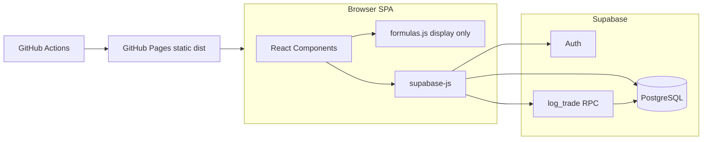

# Architecture

## Overview



## Principles

1. **Server-authoritative progression** — Level up/down and capital updates run inside `public.log_trade()` with row locking (`FOR UPDATE`). The client never writes level/capital directly except via RPC.
2. **RLS** — Users read/write only their rows (`auth.uid() = user_id`).
3. **Display math** — `src/lib/formulas.js` mirrors PRD formulas for UI labels (targets, drawdown limits, D1–D4). Must stay consistent with SQL in RPC.
4. **Static hosting** — No Node server in production; only static files + Supabase API.

## Data model

| Table | Role |
|-------|------|
| `trading_accounts` | One row per user: `current_level`, `current_capital`, `peak_capital` |
| `trades` | Journal: PnL, level at trade time, starting/ending capital |
| `level_history` | Audit when level changes (`TARGET_MET`, `DRAWDOWN_HIT`, `MANUAL_RESET`) |

Signup trigger `handle_new_user` inserts account at level 1, ₹10,000.

## Frontend modules

| Path | Responsibility |
|------|----------------|
| `App.jsx` | Session gate: Auth vs Dashboard |
| `components/Auth.jsx` | Sign up / sign in |
| `components/Dashboard.jsx` | Layout, data load, trade callback side effects |
| `components/TradeLogger.jsx` | Form → `rpc('log_trade')` |
| `components/EquityChart.jsx` | Recharts equity curve |
| `components/LevelGrid.jsx` | 42-level matrix |
| `lib/supabase.js` | Single Supabase client |
| `lib/formulas.js` | `getLevelMetrics`, `formatINR` |

## RPC response (contract)

`log_trade` returns JSONB:

```json
{
  "success": true,
  "old_level": 1,
  "new_level": 2,
  "new_capital": 15000,
  "trigger": "TARGET_MET",
  "level_changed": true
}
```

`trigger` is `NONE` when no level change.

## CI/CD

- Push to `main` → GitHub Actions → `npm ci` → `npm run build` → deploy `dist/` to `gh-pages` branch.
- Build injects Supabase env at compile time (Vite).

## PWA (optional)

PRD mentions PWA; not in MVP scaffold. See [DECISIONS.md](./DECISIONS.md) and Week 3 in [ROADMAP.md](./ROADMAP.md).

## Related docs

- [DATABASE.md](./DATABASE.md) — SQL and rules detail
- [DEPLOYMENT.md](./DEPLOYMENT.md) — Pages + base path
